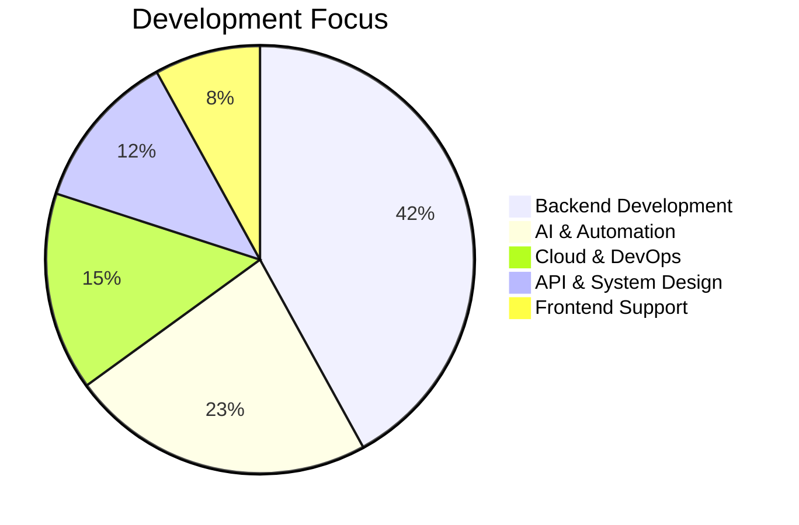

<div align="center">


</div>

<div align="center">

[](https://git.io/typing-svg)

<br/>


&nbsp;

&nbsp;


</div>

---

## `>>> class AmitKumar:`

```python
class AmitKumar:
    """
    Backend Developer crafting scalable systems,
    intelligent automation pipelines, and clean API architecture.
    Currently @ LN Webworks — building AI-powered backend products.
    """

    def __init__(self):
        self.name               = "Amit Kumar"
        self.role               = "Backend Developer — Python (Django / FastAPI)"
        self.location           = "Ludhiana, Punjab, India 🇮🇳"
        self.experience         = "3.5+ years"
        self.email              = "amitkumar.webworks@gmail.com"
        self.portfolio          = "https://portfolio-amit-kumar.vercel.app"
        self.linkedin           = "https://linkedin.com/in/amit-kumar-prajapati-314b58249"
        self.languages_spoken   = ["English", "Hindi", "Punjabi"]
        self.currently_building = "AI-powered automation systems & real-time backend pipelines"

    @property
    def programming_languages(self) -> list[str]:
        return ["Python", "JavaScript", "HTML5", "CSS3"]

    @property
    def backend_stack(self) -> list[str]:
        return [
            "Django", "FastAPI", "Flask",
            "Django REST Framework",
            "Celery", "WebSockets", "Django Channels",
            "AsyncIO", "Cron Jobs", "Async Tasks",
        ]

    @property
    def frontend_stack(self) -> list[str]:
        return ["React.js", "Next.js", "HTML5", "CSS3"]

    @property
    def databases(self) -> dict[str, list[str]]:
        return {
            "relational" : ["PostgreSQL", "MySQL"],
            "nosql"      : ["MongoDB", "DynamoDB"],
            "caching"    : ["Redis"],
        }

    @property
    def cloud_and_devops(self) -> dict[str, list[str]]:
        return {
            "cloud"      : ["AWS (EC2, S3, RDS, ECR, Lambda)", "Microsoft Azure"],
            "containers" : ["Docker", "Nginx", "Gunicorn", "Load Balancing"],
            "pipeline"   : ["CI/CD", "Heroku"],
        }

    @property
    def auth_and_security(self) -> list[str]:
        return ["JWT", "OAuth 2.0", "SAML 2.0", "RBAC"]

    @property
    def api_and_architecture(self) -> list[str]:
        return [
            "RESTful API Design", "System Design",
            "WebSockets", "Django Channels",
            "Chat Applications", "Data Sync",
        ]

    @property
    def payments_and_integrations(self) -> list[str]:
        return [
            "Razorpay", "Stripe", "PayPal",
            "Xero API", "RapidID API",
            "Superloop API", "SMILE API",
        ]

    @property
    def ai_and_ml(self) -> list[str]:
        return [
            "AI Agents", "LLMs", "NLP",
            "OpenCV", "Ollama",
            "n8n", "Zapier",
        ]

    @property
    def testing_and_quality(self) -> list[str]:
        return ["Playwright", "Selenium", "Unit Testing", "Debugging"]

    @property
    def tools_and_workflow(self) -> list[str]:
        return [
            "Git", "GitHub", "Bitbucket",
            "Cursor", "Agile",
            "API Docs", "Task Management",
        ]

    @property
    def fun_facts(self) -> list[str]:
        return [
            "📖 Philosophy reader & self-development enthusiast",
            "🏐 Volleyball player",
            "🎵 Music lover",
            "✍️  Writer & thinker",
        ]

    def __repr__(self) -> str:
        return (
            f"<Developer name={self.name!r} "
            f"exp={self.experience!r} "
            f"role={self.role!r}>"
        )

    def __str__(self) -> str:
        return f"👨‍💻 {self.name} | {self.role} | {self.location}"


# Instantiate & greet
amit = AmitKumar()
print(str(amit))
# 👨‍💻 Amit Kumar | Backend Developer — Python (Django / FastAPI) | Ludhiana, Punjab, India 🇮🇳
```

---

## 🛠️ Tech Stack & Skills

<div align="center">

<!-- Programming & Frameworks -->
<table>
<tr><th colspan="2" align="left">⚡ Programming & Frameworks</th></tr>
<tr><td>


</td></tr>
</table>

<!-- Frontend -->
<table>
<tr><th colspan="2" align="left">🎨 Frontend</th></tr>
<tr><td>


</td></tr>
</table>

<!-- Databases -->
<table>
<tr><th align="left">🗄️ Databases & Caching</th></tr>
<tr><td>


</td></tr>
</table>

<!-- Cloud & DevOps -->
<table>
<tr><th align="left">☁️ Cloud & Infrastructure</th></tr>
<tr><td>


</td></tr>
</table>

<!-- Web Server & Async -->
<table>
<tr><th align="left">⚙️ Web Server & Performance</th></tr>
<tr><td>


</td></tr>
</table>

<!-- Auth & Security -->
<table>
<tr><th align="left">🔐 Authentication & Security</th></tr>
<tr><td>


</td></tr>
</table>

<!-- Payments -->
<table>
<tr><th align="left">💳 Payments & Integrations</th></tr>
<tr><td>


</td></tr>
</table>

<!-- AI / ML -->
<table>
<tr><th align="left">🤖 AI & Machine Learning</th></tr>
<tr><td>


</td></tr>
</table>

<!-- Testing -->
<table>
<tr><th align="left">🧪 Testing & Quality</th></tr>
<tr><td>


</td></tr>
</table>

<!-- Tools -->
<table>
<tr><th align="left">🛠️ Tools & Workflow</th></tr>
<tr><td>


</td></tr>
</table>

</div>

---

## 📁 Key Projects

<table>
  <tr>
    <td width="50%" valign="top">
      <h3>🌐 Trade-Connect Portal</h3>
      <p><em>Telecom Service Orchestration Platform</em></p>
      <p>Real-time NBN diagnostics & service syncing via Superloop/SMILE APIs. Customised Jazzmin admin dashboard with RBAC. Full production backend deployment.</p>
      <p>
        
        
        
        
      </p>
    </td>
    <td width="50%" valign="top">
      <h3>🧾 ISP Billing Portal — RealWorldNetworks</h3>
      <p><em>Full ISP Billing Automation System</em></p>
      <p>Pro-rata billing algorithms, Xero API invoicing automation, automated financial reports, and real-time tracking dashboards — eliminating manual billing cycles.</p>
      <p>
        
        
        
        
      </p>
    </td>
  </tr>
  <tr>
    <td width="50%" valign="top">
      <h3>🔐 RWTS Identity Verification Platform</h3>
      <p><em>Australian Identity Document Verification</em></p>
      <p>RapidID API integration supporting 11 AU document types. Achieved <strong>98% verification accuracy</strong> with robust validation logic and exception handling.</p>
      <p>
        
        
        
      </p>
    </td>
    <td width="50%" valign="top">
      <h3>📅 Calendar Sync Engine — Red Globe Productions</h3>
      <p><em>Smart Rental Calendar Automation</em></p>
      <p>FastAPI + Celery syncing rental opportunities into unified ICS calendar feeds. Timezone-aware scheduling with intelligent conflict-resolution logic.</p>
      <p>
        
        
        
      </p>
    </td>
  </tr>
  <tr>
    <td width="50%" valign="top">
      <h3>💬 WebSocket Chat Application</h3>
      <p><em>Real-Time Multi-Room Chat System</em></p>
      <p>Django Channels + Redis channel layer for real-time broadcasting, presence tracking, and concurrent multi-room session management.</p>
      <p>
        
        
        
      </p>
    </td>
    <td width="50%" valign="top">
      <h3>🎤 AI Interview Bot</h3>
      <p><em>AI-Powered Real-Time Interview Platform</em></p>
      <p>Django web app with real-time interview features, unit tests, Playwright/Selenium E2E testing, and AI-driven Q&A flow architecture.</p>
      <p>
        
        
        
      </p>
    </td>
  </tr>
  <tr>
    <td colspan="2" valign="top">
      <h3>🏢 Kinetic HRMS &nbsp;</h3>
      <p><em>Full-Stack Multi-Tenant HR Management System</em></p>
      <p>
        End-to-end HRMS covering the complete employee lifecycle — attendance, leaves, payroll, shifts, onboarding/offboarding, and approval workflows.
        Built with a <strong>Django REST Framework</strong> modular backend, <strong>React (Vite)</strong> frontend (20+ pages), multi-tenant architecture with JWT-based RBAC, and deployed via <strong>Docker Compose</strong>.
      </p>
      <table>
        <tr>
          <td><strong>📦 Core Modules</strong></td>
          <td>
            
            
            
            
            
            
            
          </td>
        </tr>
        <tr>
          <td><strong>⚙️ Backend</strong></td>
          <td>
            
            
            
            
            
          </td>
        </tr>
        <tr>
          <td><strong>🎨 Frontend</strong></td>
          <td>
            
            
            
          </td>
        </tr>
        <tr>
          <td><strong>☁️ Infra</strong></td>
          <td>
            
            
            
          </td>
        </tr>
      </table>
    </td>
  </tr>
  <tr>
    <td colspan="2" valign="top">
      <h3>🎬 AI Reel Generator &nbsp;</h3>
      <p><em>Auto-Generate Professional Instagram Reels with Full AI Pipeline</em></p>
      <p>
        Production-ready platform that converts a <strong>topic → complete 9:16 Instagram Reel</strong> with consistent character, voice, and visual style.
        Powered by a fully async Celery chord pipeline: <strong>GPT-4o</strong> script generation → <strong>DALL·E 3</strong> character reference → <strong>Veo 3.1</strong> concurrent scene generation → <strong>ElevenLabs</strong> voiceover → <strong>FFmpeg</strong> merge with subtitles & watermark → <strong>AWS S3</strong> upload → React live-polling UI.
      </p>
      <table>
        <tr>
          <td><strong>🧠 AI Stack</strong></td>
          <td>
            
            
            
            
          </td>
        </tr>
        <tr>
          <td><strong>⚙️ Backend</strong></td>
          <td>
            
            
            
            
            
          </td>
        </tr>
        <tr>
          <td><strong>🎨 Frontend</strong></td>
          <td>
            
            
            
            
          </td>
        </tr>
        <tr>
          <td><strong>☁️ Infra</strong></td>
          <td>
            
            
            
            
          </td>
        </tr>
      </table>
    </td>
  </tr>
</table>

---

## 🎯 Expertise Areas & Development Focus

<div align="center">

### Focus Distribution



</div>

<div align="center">

| 🏗️ Specialisation | 📌 Domain | 🚀 Approach |
|:---:|:---:|:---:|
|  |  |  |
|  |  |  |
|  |  |  |

</div>

---

## 🏅 Coding Excellence & Achievements

<div align="center">

### ⚡ Development Metrics

<table>
  <tr>
    <td align="center" width="33%">
      <h3>🚀 Performance</h3>
      
      <br/><sub>Async task pipeline optimisation via Celery + FastAPI</sub>
    </td>
    <td align="center" width="33%">
      <h3>⏱️ Reliability</h3>
      
      <br/><sub>Docker + AWS + Nginx/Gunicorn load-balanced deployment</sub>
    </td>
    <td align="center" width="33%">
      <h3>🎯 Accuracy</h3>
      
      <br/><sub>RWTS Identity Verification via RapidID API</sub>
    </td>
  </tr>
  <tr>
    <td align="center">
      <h3>🤖 Automation</h3>
      
      <br/><sub>HR payroll & AI pipeline automation systems</sub>
    </td>
    <td align="center">
      <h3>📅 Experience</h3>
      
      <br/><sub>Across ISP, Telecom, Fintech, Identity & AI domains</sub>
    </td>
    <td align="center">
      <h3>📦 Productivity</h3>
      
      <br/><sub>Python automation scripts & workflow improvements</sub>
    </td>
  </tr>
</table>

</div>

<div align="center">

### 🔑 Key Achievements

&nbsp;
&nbsp;
&nbsp;
&nbsp;
&nbsp;


### 🏢 Professional Achievements

&nbsp;
&nbsp;
&nbsp;


</div>

---

## 🤝 Collaboration Opportunities

<div align="center">

*Open to collaborating on exciting projects and opportunities!*

<br/>

| 💼 Open To | 🎯 Interested In |
|:---:|:---:|
|  |  |
|  |  |
|  |  |

<br/>

[](mailto:amitkumar.webworks@gmail.com)

</div>

---


## 💼 Professional Journey

```
Timeline ─────────────────────────────────────────────────────────────────────────

  2022          Python Developer Intern — Pyspiders, Bangalore
                ├── Django full-stack development
                └── Python Development Certification (6 months)

  March 2023    Python Developer — Aviox Technologies, Mohali
                ├── Django, Flask, REST APIs
                ├── PostgreSQL, MySQL, MongoDB, DynamoDB
                └── AWS (EC2, S3, RDS), Docker, CI/CD pipelines

  August 2024   Python Django Developer — Tekki Web Solutions, Ludhiana
                ├── LivWell Insurance Portal (policy, onboarding, claims)
                └── Stripe + Razorpay multi-provider payment integrations

  March 2025    Python Developer (Backend & AI) — LN Webworks, Ludhiana  [CURRENT]
                ├── AI Agents & LLM (Ollama) automation pipelines
                ├── Celery + FastAPI async task processing  → latency ↓ 40%
                ├── Docker + AWS + Nginx/Gunicorn           → 99.9% uptime
                └── Manual processing time reduced          → 90%+

──────────────────────────────────────────────────────────────────────────────────
```

---

## 🤝 Connect With Me

<div align="center">

[](mailto:amitkumar.webworks@gmail.com)
&nbsp;
[](https://linkedin.com/in/amit-kumar-prajapati-314b58249)
&nbsp;
[](https://portfolio-amit-kumar.vercel.app)

</div>

---


<div align="center">


</div>

